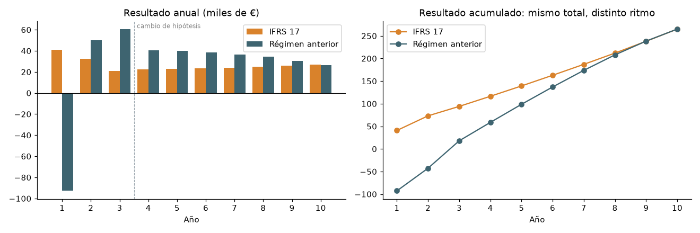
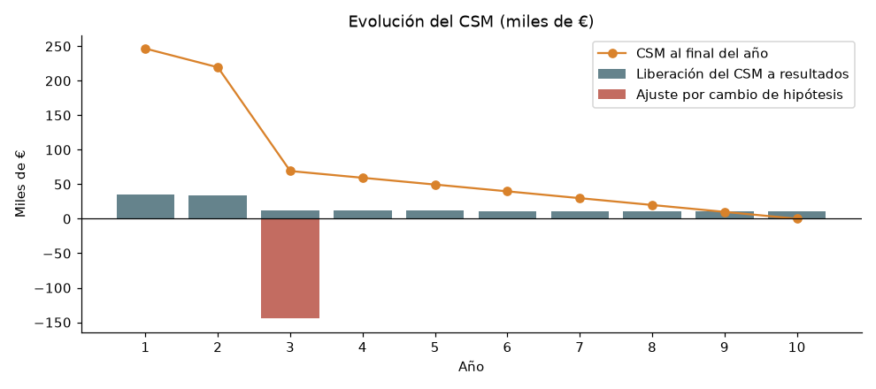
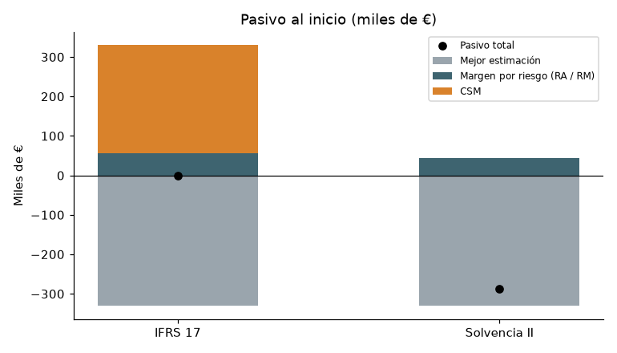

# IFRS 17 en la práctica: modelo general (GMM) frente al régimen anterior

Implementación en Python del modelo general de medición de IFRS 17 para un grupo de contratos de vida riesgo,
y comparación con números de lo que cambia frente al régimen anterior (IFRS 4 con criterio local, como el PCEA
en España) y frente a Solvencia II.



## Qué cambia con IFRS 17

| | Régimen anterior (IFRS 4 / PCEA) | IFRS 17 | Solvencia II |
|---|---|---|---|
| Ingresos | Primas emitidas o devengadas | Ingresos de seguros: servicio prestado en el periodo | No aplica |
| Pasivo | Provisiones con bases técnicas prudentes, fijadas al emitir | Flujos de cumplimiento (mejor estimación + ajuste por riesgo) + CSM | Mejor estimación + margen de riesgo |
| Beneficio futuro | Implícito; aflora según el patrón de las provisiones | CSM, liberado según las unidades de cobertura | Fondos propios desde el primer día |
| Contratos onerosos | Solo si falla la prueba de adecuación de pasivos | Pérdida inmediata al emitir | Sin CSM |
| Cambios de hipótesis | Las bases técnicas no se revisan | Los de servicio futuro los absorbe el CSM | Impacto directo en fondos propios |
| Descuento | Interés técnico fijo | Tipos actuales; el CSM acumula intereses al tipo bloqueado | Curva libre de riesgo de EIOPA |

## Resultados clave

Seguro temporal de fallecimiento a 10 años: 1.000 hombres de 40 años, capital de 100.000 €, mortalidad del INE de
2024, caídas del 5 %, descuento al 3 % y prima con un 25 % de recargo (232,57 € al año).

Reconocimiento inicial

| Concepto | € |
|---|---:|
| Valor actual de salidas menos entradas | −330.627 |
| Ajuste por riesgo (nivel de confianza del 75 %) | 56.925 |
| CSM (beneficio no devengado) | 273.702 |
| Pasivo IFRS 17 al inicio | 0 |

- No hay beneficio el primer día: el CSM se libera año a año según el capital asegurado en vigor.
- Grupo oneroso (tarifa un 10 % por debajo del coste): IFRS 17 reconoce 189.047 € de pérdida el primer día.
  En el régimen anterior la pérdida no se identifica como tal y se mezcla con los gastos del primer año.
- Cambio de hipótesis (mortalidad futura +20 % al final del año 3): el CSM absorbe 144.771 € y el resultado
  sigue siendo positivo. En cambio, el exceso de siniestralidad del año 2 (servicio pasado) va directo a resultados.
- Mismo beneficio total en los dos regímenes (265.014 €). Lo que cambia es cuándo se reconoce: IFRS 17 lo
  reparte de forma estable, mientras que el régimen anterior empieza con una pérdida de 92.797 € en el año 1
  por la adquisición y la dotación de la provisión matemática.
- Frente a Solvencia II: la misma mejor estimación, pero Solvencia II añade un margen de riesgo de 43.011 € y no
  tiene CSM, así que el beneficio futuro (287.616 €) es fondos propios desde el inicio.





## Metodología

1. Proyección de pólizas en vigor, fallecimientos, caídas, primas, gastos y siniestros.
2. Flujos de cumplimiento: valor actual de salidas menos entradas al tipo de descuento.
3. Ajuste por riesgo con la técnica del nivel de confianza: multiplicador lognormal de la mortalidad
   (desviación del 10 %) y RA = percentil 75 − media del valor actual (20.000 simulaciones).
4. CSM: al inicio, igual al negativo de los flujos de cumplimiento (si es positivo). Cada año acumula intereses al
   tipo bloqueado, se ajusta por los cambios de servicio futuro y se libera según las unidades de cobertura
   (capital asegurado en vigor).
5. Cuenta de resultados IFRS 17:
   - Ingresos de seguros = siniestros y gastos esperados + liberación del RA + liberación del CSM + recuperación de los gastos de adquisición.
   - Gastos del servicio de seguros = siniestros y gastos reales + amortización de los gastos de adquisición.
   - Resultado financiero = ingresos de las inversiones − gastos financieros de seguros.
6. Régimen anterior: primas como ingreso, gastos de adquisición a resultados y provisión matemática con bases
   técnicas prudentes (mortalidad +10 %, interés técnico del 2 %), sin revisarlas.
7. Solvencia II: margen de riesgo = 6 % × Σ SCR de mortalidad proyectado (choque del +15 % en q_x) descontado.

Los tests (`tests/test_ifrs17.py`) comprueban la coherencia contable:
- La variación de (activos − pasivo) de cada año es igual al resultado del año.
- El CSM y el pasivo se anulan al vencimiento.
- El beneficio total coincide en los dos regímenes.
- Un grupo oneroso no tiene CSM y reconoce la pérdida el primer día.

## Estructura

- `data/ine_mortality_lx.csv`: tablas de mortalidad del INE
- `src/ifrs17.py`: proyección, RA, CSM, régimen anterior y Solvencia II
- `tests/test_ifrs17.py`: tests de coherencia contable
- `notebooks/ifrs17_gmm.ipynb`: análisis completo con gráficos
- `figures/`: gráficos del análisis

## Cómo ejecutarlo

```bash
pip install -r requirements.txt
python -m unittest discover tests
jupyter notebook notebooks/ifrs17_gmm.ipynb
```

## Simplificaciones y posibles extensiones

- Tipo de descuento plano y constante: no hay efecto de cambios de tipos ni opción de OCI. Extensión: curva de
  tipos actual frente a bloqueada y desglose entre resultados y OCI.
- Un solo grupo de contratos y sin reaseguro. Extensión: varias cohortes anuales y reaseguro cedido.
- Modelo general (GMM). Extensión: enfoque de asignación de primas (PAA) para no vida y enfoque de comisión
  variable (VFA) para productos con participación en beneficios.
- RA solo por riesgo de mortalidad.

## Referencias

- IASB (2017, modificada en 2020). *IFRS 17 Contratos de Seguro*. Adoptada en la UE por el Reglamento (UE) 2021/2036.
- Reglamento Delegado (UE) 2015/35 (Solvencia II): art. 37 (margen de riesgo) y art. 137 (riesgo de mortalidad).
- Instituto Nacional de Estadística (INE): *Tablas de mortalidad*.

## Autora

Tingting Wu · [LinkedIn](https://www.linkedin.com/in/tingting-wu-8b9320243)
